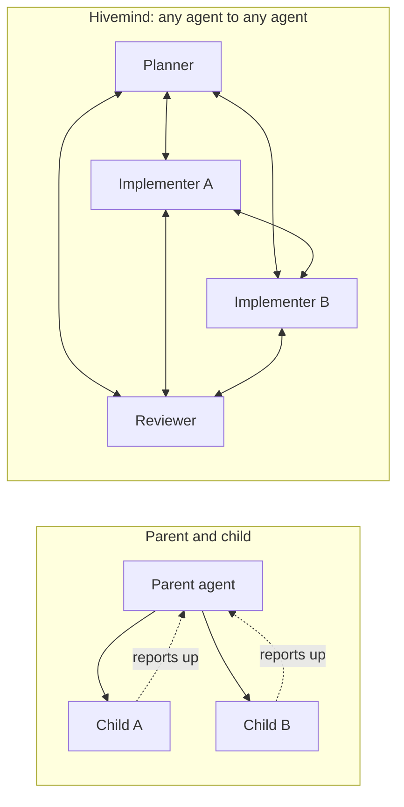
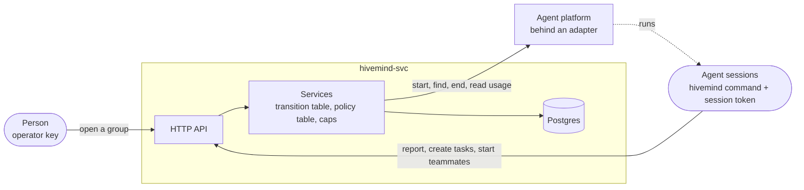
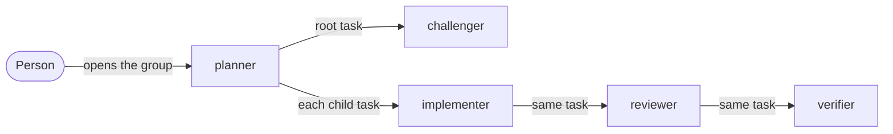
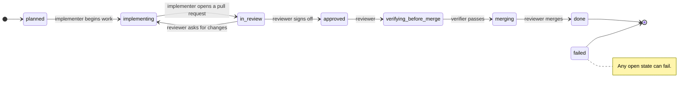
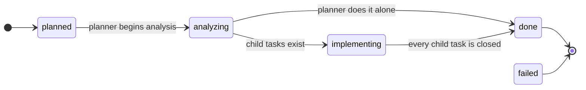

# agent-hivemind

A service that coordinates a team of AI coding agents working on one goal.

A person opens a **group**: a name, a goal, and a budget. The service starts a **planner**
agent, which splits the goal into **tasks**. Each task then passes through an
**implementer**, a **reviewer** and a **verifier**, every one a separate agent session, until
its change is merged and checked. The service writes no code. It records what each agent
reports, decides which moves are legal, caps how many agents run, and refuses new starts once a
group's budget is spent.

What sets it apart is how the agents talk. In parent-and-child orchestration, a parent starts
children and messages move up and down a tree. Here the goal is decentralized, hivemind-style
communication: any agent can message one or more other agents in its group directly.
[What makes it different](#what-makes-it-different) has the detail.

**Status: early.** The service, the `hivemind` command, the rules and the storage are built
and tested. Two large pieces are missing. The only agent platform behind it is a simulated
one, so no real agent runs yet. And the agent-to-agent messaging is not built: the policy
table allows it, but no route, command or delivery backs it. One more limit matters for the
budget: spend is read every five minutes while sessions run, and a group that has reached its
budget refuses new starts, but the agents already running are not stopped.
[Not built yet](docs/architecture.md#not-built-yet) lists every gap.

## Why this exists

A plan that lives only in a planner's conversation disappears when that session ends, and
nothing outside the conversation can say how far the work got. Running many agents adds
failures that one agent never has: two claim the last free slot, a platform call times out
after the agent already started, a retry starts it twice, and the bill grows with nobody
counting.

hivemind-svc moves those problems out of the agents and into a service with a database:

- **One durable record.** Tasks, sessions, and an append-only history of every state change
  are stored. A replacement agent reads the history and carries on.
- **Rules in two tables.** One table says which state changes are legal. Another says which
  role may do what. The service checks every report against both, so an implementer cannot
  sign off its own pull request. Only a reviewer session can.
- **Limits.** Caps on live agents (10 per group by default), starts per hour, and total
  agents per group, plus a budget in the platform's usage unit. A start that would pass a cap
  is refused.
- **Safe retries.** Every start and every state change can be repeated. A start whose reply
  was lost is found again by key instead of being started twice, and a crash between two
  steps leaves a row that the next request finishes.

## What makes it different

Most multi-agent setups are a tree. A parent agent starts children, hands each one a job, and
hears back from its own children only. Information moves up and down the tree, and two agents
on different branches cannot talk unless a parent relays for them.

agent-hivemind aims at the opposite: **decentralized, hivemind-style communication.** Any
agent can message one or more other agents in its group directly, whoever started whom. An
implementer can ask another implementer how it handled a shared interface. A reviewer can help
review a pull request that belongs to a different task. Any agent can ask the others for
information, or for advice on what a term or a design choice means in this codebase.

An agent reaches several others by finding each one and messaging each one. Semantic routing
is planned for the tool calls, so that an agent can find and message the subset of the swarm
that is relevant to it. Messaging across groups may come in a later release.



The tree does not go away. It is narrower. Who started whom decides ownership: a session
reports moves only on its own task, and it can end the members it started. Who may _talk_ to
whom is a separate rule, kept in the same policy table.

Messages are recorded in the sender's task history, and a drop is also recorded on the
recipient's task. The policy table lets every role send to one member and read messages, and
lets only the planner send to all. `hivemind send` delivers through the service.
[Who starts whom, and who talks to whom](docs/architecture.md#who-starts-whom-and-who-talks-to-whom)
lists what exists, what is missing, and what is decided.

**A peer's review is advice, never approval.** The swarm is not the adjudicator of your
approval process. Set up code-review bots and an auto-approver that stamps low-risk pull
requests and gates higher-risk ones for a person to approve. The service never reads or counts
pull-request approvals. See
[Approval stays outside the swarm](docs/architecture.md#approval-stays-outside-the-swarm).

## How it fits together



- **The service is the only thing that starts and stops sessions.** It does so through a
  platform adapter, the one piece of code that knows which platform is in use.
- **Agents coordinate only through the service.** Each agent runs the `hivemind` command with
  a token that belongs to its session. Every report, new task and new teammate goes through
  the same rules. Messages between agents are meant to travel the same way.
- **Prompts are not the enforcement.** Agents are told their role, but the service checks
  each request against the tables anyway.

## The cast

| Role        | Works on                 | Started by                     | What it does to the task                                               |
| ----------- | ------------------------ | ------------------------------ | ---------------------------------------------------------------------- |
| planner     | The root task (the goal) | A person, when the group opens | Splits the goal into child tasks. Starts challengers and implementers. |
| challenger  | The root task            | The planner                    | Adds notes to the root task. Up to 2 live at once.                     |
| implementer | One child task           | The planner                    | Does the work and opens the pull request.                              |
| reviewer    | The same child task      | The implementer                | Signs off, asks for changes, and reports the merge.                    |
| verifier    | The same child task      | The reviewer                   | Checks the change, before the merge, after it, or both.                |



This chain says who starts whom. It does not say who may talk to whom: see
[What makes it different](#what-makes-it-different).

A task has one implementer, one reviewer and one verifier at a time. If one dies, end its
session first. Its starter can then start a replacement, up to three times. The planner tells a
challenger what to look at in its start instructions. The service only enforces that a
challenger writes notes on the root task and nothing else.

## How a task moves

A task is a state machine. A session reports a move with a note, and for moves that deliver
or sign off work, a pull-request link as evidence. The service accepts the move only if that
role may make it from the task's current state.

A **child task** on its default path, where verification happens before the merge:



A task can instead verify after the merge, or both. The verifier can also send a task back
to `implementing`. The **root task**, which is the group's goal, has its own shorter machine:



Four rules hold everywhere:

- Every move needs a note.
- A closed task, `done` or `failed`, never reopens.
- When every child task is `done`, the service closes the root, and closing the root closes
  the group.
- Failing the root also fails every child task that is still open.

[docs/state-machines.md](docs/state-machines.md) has every edge, who may take it, what
evidence it needs, and the machines for sessions and groups.

## Quick start

Requires [Bun](https://bun.sh) **1.3.4** (see `.tool-versions`).

```bash
bun install
bun test        # no database server needed
bun run lint    # tsc --noEmit, then Biome
```

### Run the service

```bash
# Generate the key once and keep it with your service configuration. Reuse it on every restart:
# a different key cannot open enrollment tokens that were sealed with the old one.
openssl rand -hex 32          # run once, save the output
export HIVEMIND_RESPONSE_KEY=<the key you saved>
PORT=8787 bun run start
# Bootstrap key (shown once): opk_...
# hivemind-svc listening on http://127.0.0.1:8787
```

The service reads these variables:

| Variable                | What it does                                                                        |
| ----------------------- | ----------------------------------------------------------------------------------- |
| `HIVEMIND_RESPONSE_KEY` | Required: the service will not start without it. Generate it once and reuse it.     |
| `PORT`                  | Listen port. Unset uses an ephemeral port.                                          |
| `HIVEMIND_DATA`         | Directory for the Postgres data. Defaults to `.hivemind`.                           |
| `HIVEMIND_POSTGRES_URL` | Connection string for the PostgreSQL spawn-gate test. The service does not read it. |

In a second terminal, with the bootstrap key from the first:

```bash
BOOT=opk_...                      # the bootstrap key, valid for 24 hours
BASE=http://127.0.0.1:8787

# 1. Create the first administrator.
curl -s -X POST $BASE/v1/bootstrap/administrator \
  -H "authorization: Bearer $BOOT" -H 'content-type: application/json' \
  -d '{"display_name": "Ada"}'

# 2. Create a key that can open groups. The reply holds its secret, shown once.
curl -s -X POST $BASE/v1/bootstrap/keys \
  -H "authorization: Bearer $BOOT" -H 'content-type: application/json' \
  -d '{"name": "local", "role": "creator"}'

# 3. Open a group with that key. The planner starts on the simulated platform.
KEY=opk_...                       # the secret from step 2
curl -s -X POST $BASE/v1/groups \
  -H "authorization: Bearer $KEY" -H 'content-type: application/json' \
  -H 'idempotency-key: demo-1' \
  -d '{"name": "demo", "goal": "Add a health page", "budget": "10",
       "instructions": "Plan the work, then start implementers."}'
```

The reply to step 3 is a `201` with the group, its root task in `planned`, and the planner
session, `live`. Send step 3 again with the same key and you get the same group. Change the
body and keep the key and you get `409 idempotency_conflict`.

That is as far as a person can drive it today. The simulated platform runs no agent, so the
planner never reports back, and every other route needs a session token. To watch a whole
group go from `planned` to `done` over HTTP, run the scripted test:

```bash
bun test src/http/server.test.ts -t "scripted group reaches done"
```

## Client

`bun run hivemind` is the client for the HTTP API. Its commands are `enroll`, `whoami`, `task`,
`member`, `release`, and `resume`.

| Variable         | What it does                                                             |
| ---------------- | ------------------------------------------------------------------------ |
| `HIVEMIND_URL`   | Required service address. Use `https`, or `http` on loopback.            |
| `HIVEMIND_HOME`  | Directory for the saved token. Defaults to `~/.hivemind`.                |
| `HIVEMIND_TOKEN` | Token for this run. When unset, the client reads `$HIVEMIND_HOME/token`. |

## Where to read next

| Read                                               | For                                                                              |
| -------------------------------------------------- | -------------------------------------------------------------------------------- |
| [`docs/architecture.md`](docs/architecture.md)     | Layers, ports, authentication, storage, caps and budget, failure recovery, gaps. |
| [`docs/state-machines.md`](docs/state-machines.md) | Every task, verification-mode, session and group transition.                     |
| [`docs/adr/`](docs/adr/)                           | Decisions that were argued and settled, and why. One file per decision.          |
| [`CONTRIBUTING.md`](CONTRIBUTING.md)               | What "done" looks like, the pull request process, sign-off.                      |
| [`AGENTS.md`](AGENTS.md)                           | Rules for coding agents that work on this repository.                            |

## Tooling for coding agents working on this repo

| Surface                              | Role                                 |
| ------------------------------------ | ------------------------------------ |
| `AGENTS.md` / `CLAUDE.md`            | Always-on rules for coding agents    |
| `.cursor/BUGBOT.md`                  | Cursor Bugbot review rules           |
| `.agents/skills/`                    | Canonical skills (source of truth)   |
| `.cursor/skills/`, `.claude/skills/` | Symlinks into `.agents/skills/`      |
| `.cursor/settings.json`              | Enables the **pstack** Cursor plugin |

Skill precedence and commands are documented in [`AGENTS.md`](AGENTS.md). Humans should
read [`CONTRIBUTING.md`](CONTRIBUTING.md). Third-party skill attributions live in
[`THIRD_PARTY_NOTICES.md`](THIRD_PARTY_NOTICES.md).

## License

Apache-2.0. See [`LICENSE`](LICENSE).
