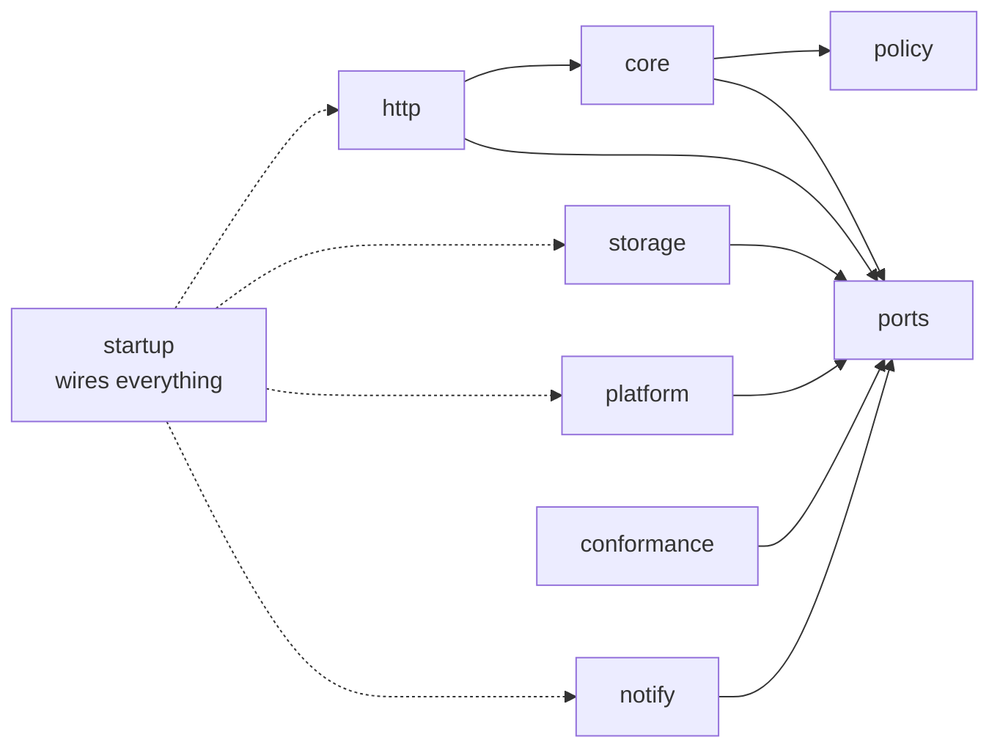
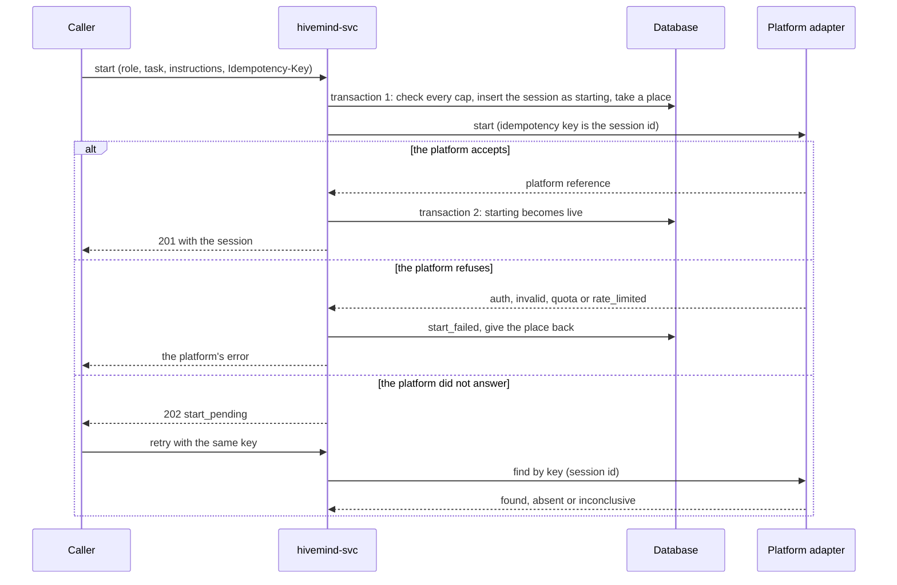
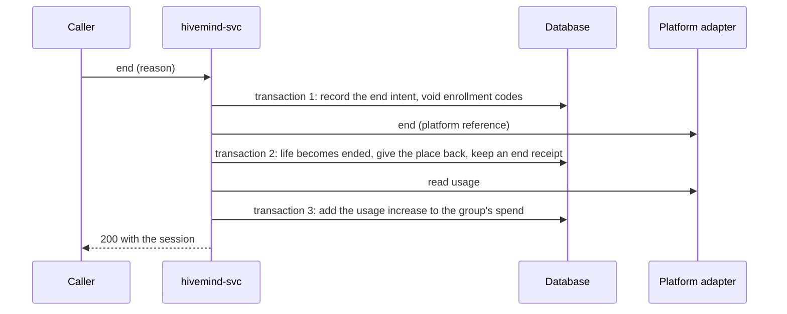

# Architecture

This page explains how hivemind-svc is built: how the code is layered, where the rules live,
how it keeps its counts honest when two requests race, and what happens when a platform call
fails halfway. The reasoning behind the big choices is in the [decision records](adr/).

The picture of the whole system, and the vocabulary (group, task, session, role), are in the
[README](../README.md). Every state change is in [state-machines.md](state-machines.md).

A group, from start to finish:

1. A person opens a group over HTTP with an operator key. The service stores the group and its
   root task, then starts a **planner** session on the platform.
2. The planner reports `planned` to `analyzing`, creates child tasks, and starts one
   **implementer** per task. Every call is the `hivemind` command with the planner's token.

   **One implementer per task is a design decision, not a limit of the current build.** An
   implementer that worked on more than one pull request at a time would thrash. Most coding
   harnesses subscribe the agent to GitHub pull-request events, so any activity on a pull
   request, from a bot or a person, interrupts the agent and forces it to switch to that pull
   request. With enough activity across several pull requests, the agent's context fills and
   the harness compacts it, and depending on the harness the agent then hallucinates. One task,
   one implementer and one pull request keeps each agent on a single stream of events. See
   [ADR 0002](adr/0002-one-implementer-per-task.md).

3. While its task is `implementing`, an implementer starts a **reviewer**, then moves the task
   to `in_review`. The reviewer signs off, starts a **verifier** if the task's verification
   mode asks for one, and reports the merge.
4. Every five minutes the worker that drains the outbox reads each running session's status
   and usage and adds the increase to the group's spend. A start is refused once a run records
   that the budget has been reached. A start can still be accepted between runs. The budget
   does not end sessions that are already running. See [Budget](#budget) and
   [ADR 0005](adr/0005-spend-is-polled-while-sessions-run.md).
5. When every child task is `done`, the service closes the root task, which closes the group.

## Who starts whom, and who talks to whom

Sessions have two relationships, and they are meant to have different shapes.

| Relationship | Shape                                       | What it decides                                                          | State |
| ------------ | ------------------------------------------- | ------------------------------------------------------------------------ | ----- |
| Starting     | A tree                                      | Who owns a task's moves, who may end whom, who may start a replacement.  | Built |
| Talking      | A mesh: any agent to any agent in the group | Who may ask for information, give advice, or help review a pull request. | Built |

The main difference between this project and parent-and-child orchestration is the second row.
In a tree, a message from one branch to another goes up to a common parent and back down. Here
a session may address any other session in its group, or several, without going through the
session that started it. The uses it is meant for are asking another agent for information,
getting advice on what a term or design choice means in this codebase, and helping review
another task's pull request. That help is advice, not approval.

The tree stays because ownership needs it: a task has one implementer, one reviewer and one
verifier at a time, and only they report its moves. A message is not a report. The policy table
gives messages their own actions, and nothing in it lets a message move a task.

The decision, with what it rules out and what is still open, is in
[ADR 0004](adr/0004-peer-messaging-within-a-group.md). The policy table lets every role send to
one member and read messages, and lets only the planner send to all. `hivemind send`, `ask`,
`answer`, `relay` and `inbox` call the message routes. The service stores each message, then the
process drains the outbox and asks the platform to deliver it. Where the task history records a
message is in [ADR 0006](adr/0006-where-a-message-is-recorded.md). Semantic routing is not built.

### Approval stays outside the swarm

A peer's review never counts as approval. The swarm is not the adjudicator of an organisation's
approval process, and the service does not read, request or count pull-request approvals. The
`approved` state (C4) says the task's own reviewer session signed off. It is a handoff, not a
merge approval. The intended setup is many code-review bots plus an auto-approver that stamps
low-risk pull requests and gates higher-risk ones for a person. See
[ADR 0003](adr/0003-approval-stays-outside-the-swarm.md).

## Layers

Code is split into layers, and Biome fails the build when a layer imports one it must not.

| Layer             | Responsibility                                                                         | May depend on                              |
| ----------------- | -------------------------------------------------------------------------------------- | ------------------------------------------ |
| domain            | Types, ids, errors, and the task transition tables with the function that applies them | Nothing else                               |
| policy            | The permission table: which role may take which action, where                          | domain                                     |
| ports             | The interfaces the services need: storage, the platform adapter and the notifier       | domain                                     |
| core              | The services, including the usage poll and the reaper, which run under the job lock    | domain, policy, ports                      |
| storage           | The Postgres store and its migrations                                                  | domain, ports                              |
| platform adapters | One adapter per agent platform. Only a simulated one exists                            | domain, ports                              |
| notify            | Sends an alert notification to a webhook                                               | domain, ports                              |
| http              | Routes, credential checks, error mapping                                               | domain, ports, core                        |
| cli               | The `hivemind` command                                                                 | Nothing in the service. It talks over HTTP |
| conformance       | A suite that checks an adapter against the platform contract                           | domain, ports                              |

Every layer except `cli` may also depend on `domain`. Arrows to it are left out of the picture.

Why it is cut this way:

- **`domain` and `policy` are pure.** They take plain values and return a decision. Neither
  touches a database, a clock, or the network, so their tests can enumerate every row: one test
  per transition row, and one allow or deny for every role, action and task state.
- **`core` cannot name a platform.** A lint rule rejects the names of platforms in `core`, the
  simulated one included. The service learns what a platform can do from its declared
  capabilities, never from its name.
- **`core` cannot see SQL or HTTP.** It works through the storage interface, so the same
  service code runs on any Postgres.
- **`cli` cannot depend on the service.** Agents reach the service the way any other client
  would.

## Ports

### Storage

The storage port gives a service one transaction with typed reads and writes, including row
locks. A service never commits. Everything a request changes lands in one transaction, or in a
deliberate sequence of them (see [Surviving failure](#surviving-failure)).

### Notifier

The notifier port sends one notification, which is one flat object of string values for one alert,
and either returns or fails. The webhook notifier is the only implementation. It is optional: with
no address set, nothing is sent. The service sets no timeout around it beyond the 10 seconds a
delivery gets, and a failure never fails the usage poll that called it.

### Platform

A **platform adapter** is the only code that talks to an agent platform. The platform is
whatever hosts the agent sessions.

| Operation              | What it does                                                                                               | Used by the service today |
| ---------------------- | ---------------------------------------------------------------------------------------------------------- | ------------------------- |
| start                  | Starts a session from a prompt, a title, settings, and an idempotency key.                                 | Yes                       |
| find by key            | Answers "did a start with this key create a session?": found, absent, or inconclusive.                     | Yes, in recovery          |
| end                    | Stops a session. Repeating it must be safe.                                                                | Yes                       |
| read usage             | Returns the session's cumulative usage. It must never go down.                                             | Yes                       |
| probe                  | Lists the capabilities the connection has.                                                                 | No                        |
| read status, read many | Read a session's neutral status: working, idle, waiting for a person, suspended, stopped, failed, unknown. | Status, on usage poll     |
| send                   | Messages a running session. Results: accepted, busy, rate limited, gone.                                   | No                        |
| suspend, describe      | Pause a session. Describe the adapter.                                                                     | Suspend, by the reaper    |

Failures carry one of six classes: `auth`, `rate_limited`, `quota`, `invalid`, `not_found`,
`unavailable`. A message never carries a credential, a prompt, or a message body. The first
four classes are **refusals**: the platform said no, so the service gives the place back.
`unavailable` means the service does not know what happened. The service sets no timeout around a
platform call, so an adapter bounds every call it makes. A call that never returns holds the job
run that made it, and no other run starts in that process until it returns. See
[ADR 0007](adr/0007-a-job-lock-keeps-each-background-job-to-one-process.md).

Nine capabilities exist, and the service reads two. `usage_reading` is required to open a
group, because a budget cannot work if usage cannot be read. `secret_injection` decides how a
session gets its token (see [Authentication](#authentication)).

A conformance suite of eleven cases checks an adapter against the contract: idempotent start,
repeatable end, usage that never goes down, no secrets in errors, find by key, and others. It
runs against controls that stand in for a recorded platform, so it never touches the network.
Only the simulated adapter has been run through it.

## Authentication

There are three credentials.

| Credential      | Looks like | Stored as                    | Used for                           |
| --------------- | ---------- | ---------------------------- | ---------------------------------- |
| Operator key    | `opk_…`    | SHA-256 hash, with a role    | Bootstrapping, and opening a group |
| Session token   | `ses_…`    | SHA-256 hash on the session  | Everything an agent does           |
| Enrollment code | `enr_…`    | SHA-256 hash, 15 minute life | Trading for a session token, once  |

The first start on an empty database creates the default workspace and a **bootstrap key**,
prints it once, and lets it live for 24 hours. The bootstrap key creates the first
administrator, then operator keys with the role `reader`, `creator` or `administrator`. Only
`creator` and `administrator` keys can open a group. A `reader` key can do nothing today.

**How a session gets its token.** The prompt never carries a token. What happens next depends
on the platform's `secret_injection` capability:

- With it, the service mints the token when it reserves the session and hands it to the
  platform as a secret named `HIVEMIND_TOKEN`. The agent's first authenticated call counts as
  enrollment.
- Without it, the prompt carries an enrollment code and the agent runs `hivemind enroll`. The
  code is good for 15 minutes and is voided after five wrong attempts. Enrolling returns the
  token once. A repeat of the same request returns the same token only while
  `HIVEMIND_RESPONSE_KEY` is unchanged: the service seals the stored token with that key, and a
  different key cannot open it. The code stays used, so the agent cannot enroll again. The
  command saves the token to a file that only its owner can read.

The service listens on loopback only, and the `hivemind` command refuses a URL that is neither
HTTPS nor loopback.

## Who may do what

The policy table answers one question: may this role take this action here? It reads the role,
whether the session is released, whether the task is the session's own, and the states of the
task and of the root.

A session counts as **live** until it releases (see
[state-machines.md](state-machines.md#sessions)). A **released** session gave its place back,
so it keeps only the "any life" actions below. Starting a replacement follows the same edges as
starting a member.

**Planner**

- Any life: read tasks and list members. Report moves on the root task, and fail it. Add a note
  to any task. End itself.
- Live only: create a child task while the root is `analyzing` or `implementing`. Edit a child
  task's title or description while it is `planned`. Fail any open task. Start a challenger on
  the root, or an implementer on a child task that is `planned` or `implementing` while the
  root is open. End a member it started, or any member whose task is closed. Release itself.

**Challenger**

- Any life: read tasks and list members. Add a note to the root task. End itself.
- Live only: release itself.

**Implementer**

- Any life: read tasks and list members. Report moves on its own child task. Fail it while it
  is `planned` or `implementing`. Add a note to it. End itself once the task is closed.
- Live only: start a reviewer on its own task while it is `implementing`. End a member it
  started, once that member's task is closed. Release itself.

**Reviewer**

- Any life: read tasks and list members. Report moves on its own child task. Fail it while it
  is `in_review`, `approved` or `merging`. Move its verification mode later. Add a note to it.
  End itself once the task is closed.
- Live only: start a verifier on its own task while it is `in_review`, `approved` or `merging`.
  End a member it started. Release itself.

**Verifier**

- Any life: read tasks and list members. Report moves on its own child task. Fail it while it
  is `verifying_before_merge` or `verifying_after_merge`. Add a note to it. End itself at any
  time.
- Live only: release itself.

A person who owns the group, or an administrator, can fail any open task and can start a
planner on the root task. Opening a group is the only place that starts a planner. See
[who may fail a task](state-machines.md#who-may-fail-a-task) for the whole list.

Each session is told its role in its prompt, along with the group, the task, the verification
mode, who started it, seven standing rules, and the starter's instructions. It names the
changeset only for the implementer, reviewer and verifier. Because a prompt can be ignored, the
service checks every report against this table and the transition table anyway.

## Storage

One default workspace exists, but every row carries a workspace id. Storage is Postgres. By
default the service starts an in-process Postgres that keeps its files in a data directory
(`.hivemind`, or `HIVEMIND_DATA`). The same SQL and migrations also run on a Postgres server.

| Table                  | Holds                                                                                             |
| ---------------------- | ------------------------------------------------------------------------------------------------- |
| `workspaces`, `people` | The workspace and its limits. People with the role `member` or `administrator`.                   |
| `operator_keys`        | Hashed keys, role, expiry, revocation.                                                            |
| `groups`               | Goal, budget, spend, the caps copied at creation, and the place counters.                         |
| `tasks`                | The root and child tasks, with `version`, `changeset_id` and `changeset_round`.                   |
| `task_events`          | The append-only history, numbered per group by `sequence`.                                        |
| `sessions`             | One row per session: role, `life`, token hash, platform reference, end intent, usage.             |
| `enrollment_codes`     | Hashed codes with expiry, attempts, and use.                                                      |
| `spawn_log`            | One row per start, which the spawn-rate cap counts.                                               |
| `idempotency_keys`     | Every remembered request and its stored response.                                                 |
| `connections`          | Which adapter the workspace uses.                                                                 |
| `job_locks`            | One row per background job: who holds the lock, its expiry, and its lock id. No workspace column. |
| `planned_actions`      | An action a job recorded before it called the platform. One open row per target.                  |
| `session_job_state`    | What the background jobs remember about one session between runs.                                 |
| `alerts`               | A condition a person must see. One open row per rule and target, with `notified_at`.              |
| `alert_deliveries`     | One notification for one alert: its state, its attempts, and its stable delivery id.              |

The database enforces what code must never break:

- One root task per group.
- At most one `starting`, `live` or `released` session per task and role, except for
  challengers.
- Task history is append-only: a trigger rejects every update and delete.
- An alert has at most one outstanding notification: a unique index on `alert_deliveries` allows one
  `sending` or `failed` row per alert.
- A closed task cannot change state: a trigger rejects it.
- Checks on every enumeration, on `budget > 0`, on `spend >= 0`, and on every counter `>= 0`.
- There is no check that `spend <= budget`. A later migration dropped it. A final usage reading
  above the budget is stored, and it blocks the next start.

Migrations are numbered SQL files and are forward only. See
[ADR 0001](adr/0001-forward-only-sql-migrations.md). Checks are added as `NOT VALID` in one
migration and validated in a later one, so no single file holds a long lock while the previous
release is still serving. An index on an existing table is built `CONCURRENTLY` in its own
`.no-transaction.sql` file, which the runner executes one statement at a time. See
[ADR 0009](adr/0009-a-migration-that-cannot-run-in-a-transaction-lives-in-its-own-file.md).

## Capacity and money

### Places and locks

A **place** is one unit of capacity. The counters live on the group and the workspace, and they
change in the same transaction that inserts, ends, or releases a session. Two overlapping
starts therefore cannot both take the last place. A CI job runs two clients against a Postgres
server, competing for the last place, to prove it.

A transaction that locks more than one of these takes the locks in one order: a background
job's lock row, workspace, group, root task, child task, session. A different order is how two
requests deadlock.

The store refuses a lock that comes after a later one in this list, so a path that breaks the
order fails whichever test runs it. Locking something the transaction already holds is allowed.
The in-process database runs one transaction at a time and cannot show a deadlock itself, so a
race needs a test with two connections in a `*.postgres.test.ts` file, which CI runs against a
PostgreSQL server.

### Caps

Caps are copied onto a group when it opens, so changing the workspace's limits later does not
touch a group that already exists. A start or resume that would pass a cap fails with
`cap_reached`, and the details name the cap, its limit, and the current value.

| Cap                       | Default                                | Counts                             | Checked on        |
| ------------------------- | -------------------------------------- | ---------------------------------- | ----------------- |
| `live_sessions`           | 10                                     | Places in use in the group         | Start, resume     |
| `live_per_role`           | planner 1, challenger 2, implementer 4 | Places in use by that role         | Start, resume     |
| `live_per_task_role`      | reviewer 1, verifier 1                 | Live sessions on one task          | Start, resume     |
| `spawn_rate`              | 6                                      | Starts in the last hour            | Start             |
| `respawns_per_task_role`  | 3                                      | Replacements for one task and role | Replacement start |
| `total_sessions`          | 50                                     | Every start, for ever              | Start             |
| `workspace_live_sessions` | 50                                     | Places in use in the workspace     | Start, resume     |
| `budget`                  | set per group, a positive decimal      | Spend so far                       | Start, resume     |

A second session for the same role on the same task is a `conflict`, not a cap. Challengers are
the exception.

### Budget

A group has a `budget`, and `spend` is what its agents have used so far, as a decimal string. A
start or resume is refused once spend reaches the budget. A usage reading only ever adds the
increase over what the service already stored for that session, so a reading never lowers it.

The code has an owner-or-administrator "raise" and an administrator "correct", which may lower
a budget but not below spend. No HTTP route calls either.

The usage poll reads the usage of every running session every five minutes and adds the increase
to spend, in that connection's unit. A reading from another connection is not added. A run starts
no new read after four minutes, and it skips the rest of a connection once a read from it fails,
so a session can wait longer than five minutes for its next reading and a start can be accepted
against spend that lags. The timer lives in the process that drains the outbox. A row in
`job_locks` decides which process does the poll when several are up. A final reading when a
session ends counts the last stretch. A poll of a session that is still running does not clear the
flag that says its final reading is still owed. A session that has ended is read on every run
until the platform says it stopped or no longer knows it, and until it owes no platform stop: only
the end path and the reaper clear that flag. A start is refused once a run records that spend has
reached the budget. A start can still be accepted until the next run. The budget does not end
sessions that are already running. See [ADR 0005](adr/0005-spend-is-polled-while-sessions-run.md)
and [ADR 0007](adr/0007-a-job-lock-keeps-each-background-job-to-one-process.md).

At the end of each run the usage poll also decides which alerts should be open. An alert is a row
for a condition a person must see, such as a session that looks stopped while its task is open, a
session waiting for a person, spend at 80 percent of the budget, or a task with no activity for
hours. The key is the rule and the target. The poll opens a missing alert, keeps an open one, and
clears one whose condition ended. A rule that needs the platform's answer neither opens nor clears
while that connection failed to answer in the run. `hivemind escalate` lets a session ask for
help. It opens one `escalation` alert for the session, and it is the one request that writes an
alert. A second call updates the reason, and the poll keeps the alert open until the session ends.
A group may open ten escalations in an hour.

After it sets the alerts, the poll sends one notification for each alert that is due, through the
webhook when `HIVEMIND_WEBHOOK_URL` is set. An alert is notified at most once per reminder
interval, even if it clears and returns, because a new row for the same rule and target inherits
when the earlier rows were last notified, as long as that was less than one interval ago. So a new
incident soon after a notified one waits out the rest of the interval, and one that returns later
is notified at once as a new alert. The interval is four hours for a critical alert and a
day otherwise, and reminders stop after a week. An alert that was not notified within a day of
opening is never first notified. A run sends at most five notifications, so a burst of alerts is
spread over several runs, and each send is cut off after 10 seconds. A notification that fails is
sent again after five minutes, then after twice as long, up to an hour, and it is dropped when it
is a day old or its alert is too old for it. With no webhook the alert row is the inbox. See
[ADR 0007](adr/0007-a-job-lock-keeps-each-background-job-to-one-process.md) and
[ADR 0008](adr/0008-a-notification-is-one-signed-delivery-for-one-alert.md).

The body is a flat object of strings, because a Slack Workflow webhook trigger takes only flat
key-value pairs. Its keys, signature and headers are in the
[README](../README.md#receive-alert-notifications). The reason of an escalation is free text that
the session wrote and is redacted only for this service's own token formats, so treat the webhook
as an internal channel.

## Surviving failure

A platform call can fail after it succeeded: the agent started and the reply was lost. A
request can be repeated. The process can stop between two steps. The design assumes all three
and leaves a row that the next request can finish.

### Idempotency

A request that creates something or moves state takes an `Idempotency-Key` header. The service
remembers the result under the key (workspace, caller kind, caller id, route, key) together
with a hash of the body.

| Same key and body         | Same key, different body | First request still running               |
| ------------------------- | ------------------------ | ----------------------------------------- |
| Returns the first result. | `idempotency_conflict`   | `request_in_progress`, or `start_pending` |

The `hivemind` command reuses one key across its own retries within a run, and uses a new key
for each new run. Enrollment is the exception: its key comes from the request, so a lost reply
followed by a fresh run returns the same token, while the response key is unchanged.

### Starting a session

The first transaction does all the checking, so a start that fails a cap is rejected there and
never reaches the platform. On success it writes the session, a spawn-log row, the place
counts, the idempotency record, the enrollment code or token hash, and a `session_started`
event. The platform call is outside any transaction, and its idempotency key is the session's
own id.

On a retry, the lookup by key decides what to do:

- **found**: complete the start, as if the first reply had arrived.
- **absent**: if an end was requested, finish it. Otherwise, unless something proves the
  session exists, give the place back with `start_failed`. The new session's first
  authenticated call, or its enrollment, counts as proof, even if the service never heard the
  platform's reply.
- **inconclusive**: change nothing, and answer `start_pending` again.

### Ending a session

The **end receipt** is the old token's hash, kept with the idempotency records. A session that
never saw the reply can call end again with that token and learn the outcome, and nothing else
accepts the token.

### Where it can stop

The process can stop after any committed step. Each stop leaves a row that the next request
finishes:

| The process stops after                                         | The row is                                   | The next request                                                                         |
| --------------------------------------------------------------- | -------------------------------------------- | ---------------------------------------------------------------------------------------- |
| Reserving the place, before the platform call                   | `starting`, no platform reference            | A retry with the same key looks the session up by key. Found completes, absent gives up. |
| The platform accepted the start, before the service recorded it | `starting`, and a platform session exists    | A retry finds it by key and completes the start.                                         |
| Recording the end intent                                        | End requested, `life` unchanged              | A retry on either end route finishes the stop.                                           |
| The platform stopped the session, before the row ended          | Stopped on the platform, row not yet `ended` | A retry repeats the stop, which every adapter must allow, then ends the row.             |

A platform session can also appear after the service decided it did not exist, or after the row
had already ended. Recovery looks again by key, stops it, and reads its usage. A stop that
fails stays pending, and the next end or start retry picks it up.

### Limits of the recovery

A retry that arrives while the first start is still talking to the platform is kept pending by
a set in process memory. A second service process would not see that set. The service runs as
one process today.

## Not built yet

This list is the gap between what the code models and what a running system can do.

1. **Semantic routing is not built.** A session can message one member, or the planner can
   message every member. It cannot yet ask the service to choose the members a question is
   about. See [ADR 0004](adr/0004-peer-messaging-within-a-group.md).
2. **A budget does not end sessions that are already running.** The usage poll records spend
   while they run and refuses the next start. Telling those sessions to finish, and ending them
   after a grace period, is not built. A reaper that ends an agent for context rot is not built
   either. The reaper that is built ends sessions whose task has been closed, and it finishes a
   start or an end that stopped halfway. See
   [ADR 0005](adr/0005-spend-is-polled-while-sessions-run.md).
3. **No real platform.** The only adapter is the simulated one. It lives in the service's
   process, hands out made-up addresses, and records sessions without running an agent. A local
   run starts a planner that never reports. The tests are where a whole group runs.
4. **A person can open a group and read or send its mail.** Ending a session, failing a task,
   and changing a budget still have no person route, though the services behind each accept a
   person as the actor.
5. **Nothing starts a second planner.** A person starts the planner when opening a group, and
   no policy row lets a session start one. A group whose planner ends cannot get another.
6. **The adapter's probe is never called, and environment reports have a policy row but no
   route.** The usage poll does write `last_status`, so a replacement can see a status of
   stopped, failed, or unknown.
7. **Three workspace limits are stored and never checked.** `live_groups`, `groups_per_day` and
   `members_read_all`. Only `live_sessions` is enforced.
8. **Task dependencies do nothing.** `depends_on` is validated, but HTTP always creates a task
   with none, and no code orders work by it.
9. **Group context is empty.** Context notes and per-group session settings (model tier,
   repositories) exist in the model. HTTP never sets them, and the prompt does not include
   notes.
10. **A Postgres server is tested but not wired.** The server driver runs the same SQL and is
    exercised by one CI job, but startup always uses the in-process Postgres.
11. **Sign-in is a stub.** The `accounts` table exists, and a person's account id is always
    null.
12. **No console and no way to acknowledge an alert.** An alert is a row, and a webhook receives a
    notification for it, but a console view of the alerts and a way to mark one as read are not
    built. An alert about a failing connection needs the daily probe, which is not built either.
