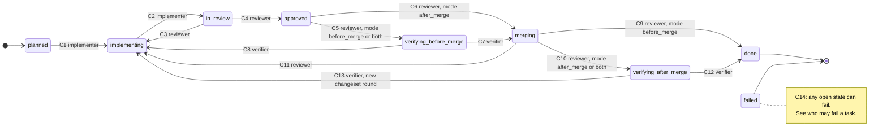
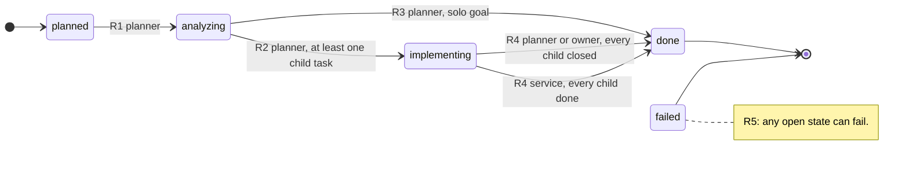
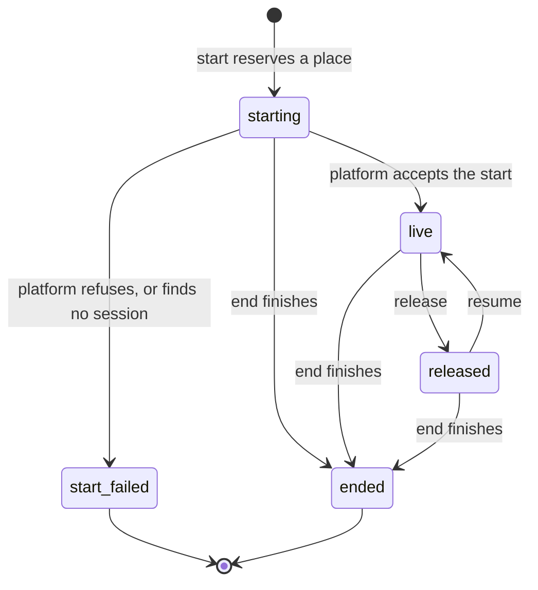

# State machines

Four things in hivemind-svc change over time: a **task**, a task's **verification mode**, a
**session** (one agent running on a platform), and a **group** (one goal, one budget). This
page lists every legal change, who may make it, and what it needs or costs.

The task rules are data in `src/domain/transition-rows.ts`, applied by one function,
`decideTransition`. A session's life has no table. It is spread across `src/core/session-*.ts`,
so this page is the only place it is written down as a whole. When you change a row, a policy
rule, or a session edge, change this page in the same pull request.

For the architecture around these machines, read [architecture.md](architecture.md).

## Tasks

Every group has one **root task**, which is the group's goal, and any number of **child
tasks** under it. Children do not have children. Both kinds draw from the same ten states,
but they follow different tables: C1 to C14 for children, R1 to R5 for the root. A new task
of either kind starts in `planned`.

A move is a **report**. The reporter names the task, the state it wants, a note, optional
evidence, and the `version` of the task it last read.

### How a report is decided

The checks run in this order, and the first failure wins:

1. **Replay.** A repeated `Idempotency-Key` with the same body returns the first result.
2. **Version.** The reported `version` must equal the task's current one, or the answer is
   `conflict`. The reporter reads the task again and reports with the new version.
3. **Policy.** For a session caller, the [policy table](architecture.md#who-may-do-what) must
   allow its role to report on this task in this state, or the answer is `policy_denied`. A
   released session may still report on its own task.
4. **Transition table.** `decideTransition` runs these tests:
   1. A closed task (`done` or `failed`) never changes state: `invalid_transition`.
   2. A verification-mode change, if the report carries one, must be legal (see below).
   3. A row must match the task kind, the target state, the current state, and the reporter.
      No such row: `invalid_transition`.
   4. The row's condition must hold: `condition_not_met`. For the root, an open child
      task gives `children_open` instead.
   5. The note and evidence must meet the row's need: `evidence_required`.
5. **Apply.** The task gets the new state and `version + 1`, an event is appended to its
   history, and a closing root closes the group.

Two things back this up in the database. A trigger on `tasks` rejects any change to the
state of a closed task, and a trigger on `task_events` rejects every update and delete.

### Evidence

Every report needs a **note**: non-blank, at most 4 KiB. Evidence entries are optional
unless the row asks for them. Each entry has a label (1 to 40 characters) and a value
(non-blank, at most 2 KiB). A malformed entry fails the report even when the row needs none.

| Need in the tables | What the report must include                                                 |
| ------------------ | ---------------------------------------------------------------------------- |
| note               | The note only.                                                               |
| address            | One entry of kind `address` whose value is an `http` or `https` web address. |
| any                | One entry of either kind with a non-blank value (`address_or_description`).  |

An address is normally the pull request. The service checks that it is a web address. It
does not fetch it.

### Child tasks

| ID  | From                   | To                     | Reporter    | Needs   | Condition                        |
| --- | ---------------------- | ---------------------- | ----------- | ------- | -------------------------------- |
| C1  | planned                | implementing           | implementer | note    |                                  |
| C2  | implementing           | in_review              | implementer | address |                                  |
| C3  | in_review              | implementing           | reviewer    | note    |                                  |
| C4  | in_review              | approved               | reviewer    | address |                                  |
| C5  | approved               | verifying_before_merge | reviewer    | note    | Mode is `before_merge` or `both` |
| C6  | approved               | merging                | reviewer    | note    | Mode is `after_merge`            |
| C7  | verifying_before_merge | merging                | verifier    | any     |                                  |
| C8  | verifying_before_merge | implementing           | verifier    | note    |                                  |
| C9  | merging                | done                   | reviewer    | address | Mode is `before_merge`           |
| C10 | merging                | verifying_after_merge  | reviewer    | address | Mode is `after_merge` or `both`  |
| C11 | merging                | implementing           | reviewer    | note    |                                  |
| C12 | verifying_after_merge  | done                   | verifier    | any     |                                  |
| C13 | verifying_after_merge  | implementing           | verifier    | note    |                                  |
| C14 | any open state         | failed                 | see below   | note    |                                  |

Four edges send a task back to `implementing`: C3 and C11 from the reviewer, C8 and C13 from
the verifier. Each needs only a note, which is where the reporter says what has to change.
C13 is the only edge that raises `changeset_round`. A task reaches C13 after the merge, so the
fix cannot go in the same changeset.

C4 records that the task's own reviewer signed off. It is not a merge approval. The service
never reads or counts pull-request approvals, and a peer's review does not move a task. See
[Approval stays outside the swarm](architecture.md#approval-stays-outside-the-swarm).

### Verification mode

Each task has a verification mode. It decides which verify steps the child task passes
through after sign-off:

| Mode           | Path after `approved`                                        |
| -------------- | ------------------------------------------------------------ |
| `before_merge` | verifying_before_merge, merging, done                        |
| `both`         | verifying_before_merge, merging, verifying_after_merge, done |
| `after_merge`  | merging, verifying_after_merge, done                         |

A group has a default mode, `before_merge` unless the person who opens the group picks
another. A child task copies it unless the planner sets one when creating the task.

A mode can only move later: `before_merge` to `both` to `after_merge`. Only a reviewer can
move it, only on a child task, and only inside a transition report. The HTTP body carries
`verification_mode` next to `to`. The `hivemind` CLI has no flag for it yet. The move is
applied before the transition is judged, so C5, C6, C9 and C10 see the new mode. It is
written to the history as a `verification_mode_changed` event. An earlier mode is refused
with `condition_not_met`.

### Root task

| ID  | From           | To           | Reporter                                         | Needs   | Condition                                                      |
| --- | -------------- | ------------ | ------------------------------------------------ | ------- | -------------------------------------------------------------- |
| R1  | planned        | analyzing    | planner                                          | note    |                                                                |
| R2  | analyzing      | implementing | planner                                          | note    | At least one child task exists.                                |
| R3  | analyzing      | done         | planner                                          | address | Solo goal: no child task, and no implementer has ever started. |
| R4  | implementing   | done         | planner, or the group owner, or an administrator | note    | At least one child, and every child is `done` or `failed`.     |
| R4  | implementing   | done         | service                                          | note    | At least one child, every child is `done`, and none `failed`.  |
| R5  | any open state | failed       | see below                                        | note    |                                                                |

Notes on the root:

- **The planner creates child tasks** only while the root is `analyzing` or `implementing`,
  which is why R2 needs at least one.
- **The service closes the root on its own** when the last child reaches `done` and none
  failed. It checks after every child closes and when the root enters `implementing`. If any
  child failed, the root stays open until the planner, the owner, or an administrator closes
  it with R4.
- **A refused implementer does not block a solo goal.** R3 ignores implementer sessions that
  ended as `start_failed`.
- **Closing the root closes the group.** Failing the root also fails every open child task,
  with the note "root task failed".

### Who may fail a task

C14 and R5 are the same rule, so one list covers both. A task that is already closed cannot
fail.

| Reporter                          | May fail                                                                                           |
| --------------------------------- | -------------------------------------------------------------------------------------------------- |
| The group owner, an administrator | Any open task. No HTTP route reaches this yet. See [not built yet](architecture.md#not-built-yet). |
| A live planner                    | Any open task.                                                                                     |
| A released planner                | The root task.                                                                                     |
| An implementer                    | Its own task while `planned` or `implementing`.                                                    |
| A reviewer                        | Its own task while `in_review`, `approved` or `merging`.                                           |
| A verifier                        | Its own task while `verifying_before_merge` or `verifying_after_merge`.                            |

The implementer, reviewer and verifier rows also hold while the session is released. Those
are the states where that role can already report a move.

## Sessions

A session is one agent running on a platform. Its row has a `life`, and its life moves like
this:

A **place** is one unit of capacity: a count in `live_sessions` on the group and workspace,
and in the per-role counters. `total_sessions` counts every start for the life of the group
and never goes down.

Each edge below lists its trigger and what it does to the places.

- **Start, into `starting`.** A start request passes every cap. Places: +1 live, +1 total.
  It inserts the row, a spawn-log row and a `session_started` event.
- **`starting` to `live`.** The platform accepts the start, or a lookup by key finds the
  session. Places: none. It stores the platform reference and address.
- **`starting` to `start_failed`.** The platform refuses the start with `auth`, `invalid`,
  `quota` or `rate_limited`, or a lookup by key finds nothing and nothing proves the session
  exists. Places: -1 live. It clears the token, voids enrollment codes, and writes
  `session_start_failed`. The spawn-log row stays, so the start still counts toward
  `spawn_rate`. A refused start does not count as a replacement.
- **`live` to `released`.** The session calls release. Places: -1 live. There is no platform
  call, and the agent keeps running.
- **`released` to `live`.** The session calls resume. Places: +1 live. It needs an open group,
  an open task, and room under the caps. There is no platform call.
- **`starting`, `live` or `released` to `ended`.** An end finishes (see below). Places: -1 live,
  unless the session was already released. It clears the token, writes `session_ended`, then
  reads the final usage.

`start_failed` and `ended` are final. Releasing a session that is still `starting` is a
`conflict`. Only a `released` session can resume.

**A released session still holds its role.** The `sessions_one_holder` index counts
`released` rows, so no second implementer, reviewer or verifier can take that task while the
first is released. A released session can still read, add notes, and report moves on its
own task. It cannot create tasks or start members. The agent prompt tells a session to
release instead of ending while it owns an open pull request.

**Resume checks fewer caps than a start.** It checks the budget, `live_sessions`, the
per-role or per-task-role cap, and the workspace cap. It skips `spawn_rate`,
`total_sessions` and the respawn cap, because a resume is not a new session.

### Ending a session

An end is three steps so that a crash between any two of them leaves a row the next request
can finish. The row's `life` does not change until step 2, and the gap before it is marked by
`end_requested_at`:

1. **Record the intent.** `end_requested_at`, the actor, and the reason are written, and
   enrollment codes are voided.
2. **Stop the platform session**, then mark the row `ended` and give the place back.
3. **Read the final usage** and add the increase to the group's `spend`.

While `end_requested_at` is set and `life` is not yet `ended`, the session's token works for
reads and for the two end routes. Every other request answers `session_not_active`. If the
platform stop fails, the answer is `unavailable` ("The platform did not stop the session")
and either end route can be retried. A `not_found` answer from the platform's end call is a
stop that already finished, so the pending stop is cleared the same way a successful stop is.
The usage poll does not clear that flag.

Who may end a session is in the [policy table](architecture.md#who-may-do-what). In short: a
planner, challenger or verifier may end itself at any time. An implementer or reviewer may
end itself only after its task has closed. Beyond itself, a planner may end the members it
started and any member whose task has closed. A reviewer may end the members it started. An
implementer may end the members it started once their task has closed.

Closing a group does not end its sessions in that request. The reaper ends every session of a
task that has been closed for 60 minutes. It also resolves a `starting` row older than 10
minutes, and it resumes an end that stopped after the intent was recorded. It does not start a
session, and it does not end a session whose task is still open.

### Replacing a session

A replacement is a start for a role that already has a session on the task. It uses the same
policy edges as a first start, and the same caps, plus a respawn cap. The new row gets the
next `attempt` number, and its prompt tells the agent to read the task history first.

The old session must be dead. The check accepts `ended` and `start_failed`. It also accepts a
last platform status of `stopped`, `failed` or `unknown`, which the usage poll writes. Anything
else is a `conflict`: "That session still holds the role."

For every role except challenger, a second check follows. The `sessions_one_holder` index counts
a row that is still `starting`, `live` or `released`, so the start is refused with a `conflict`
("This role on this task already has a session.") until the old session is `ended` or
`start_failed`. A platform status alone does not free the role. A challenger has no such index,
so a status of `stopped`, `failed` or `unknown` is enough for a challenger replacement.

### Escalating to a person

A live or released session can escalate with `hivemind escalate --reason`. The call opens one
`escalation` alert for that session. A second call with a different reason updates the alert, and
one with the same reason changes nothing. The usage poll keeps the alert open until the session
ends, then clears it. The reason is capped at 1,024 bytes and has this service's tokens redacted.
An escalation is critical, so with a webhook configured it is notified once and reminded every four
hours for a week, as long as the webhook accepts the deliveries: one that cannot be sent for a day
expires and is dropped.

A group opens at most ten escalations in an hour, and the next one is `rate_limited`. A session
that already has an alert can still update it. A session that has ended cannot escalate: ending
clears its token, so the answer is `unauthenticated`. A session whose end is requested but not
finished gets `session_not_active`.

## Groups

A group is `open` until its root task closes, then `closed`. A closed group refuses new
starts and resumes with `group_closed`. Nothing reopens it.

A group also closes when its planner cannot start. Opening a group creates the group and the
root task, then starts the planner. If the platform refuses that start, or the start throws
(a cap, for example), or a retry finds the planner as `start_failed`, the service fails the
root task and that closes the group.

## Alert notifications

An alert is notified through a row in `alert_deliveries`. A row is in one of four states, and an
alert has at most one row that is `sending` or `failed`.

| From                               | To        | When                                                                                                                                                                    |
| ---------------------------------- | --------- | ----------------------------------------------------------------------------------------------------------------------------------------------------------------------- |
| none                               | `sending` | A run records it before it sends, with `attempts` 1 and a delivery id that is now fixed.                                                                                |
| `sending`                          | `sent`    | The webhook accepted it. The alert's `notified_at` is set.                                                                                                              |
| `sending`                          | `failed`  | The webhook refused it, could not be reached, or did not answer in 10 seconds.                                                                                          |
| `failed`, or `sending` for a while | `sending` | A run sends it again under the same id and `attempts` goes up by one. It waits 5 minutes, then twice as long after each send, up to an hour, counted from `updated_at`. |
| `sending`, `failed`                | `expired` | It is a day old, its alert has closed, or its alert is too old for it.                                                                                                  |

`sent` and `expired` are final. An alert is too old for a first notification when it has been open
for a day, and for a reminder when it has been open for a week.

An open alert is due when it has no outstanding delivery and either was never notified and opened
less than a day ago, or was notified at least one reminder interval ago and opened less than a week
ago. The interval is four hours for a critical alert and a day otherwise. A new alert row for the
same rule and target inherits when the earlier rows were last notified, so a condition that clears
and returns is notified at most once per interval. A run sends at most five deliveries, critical
first and then the alert open longest.
